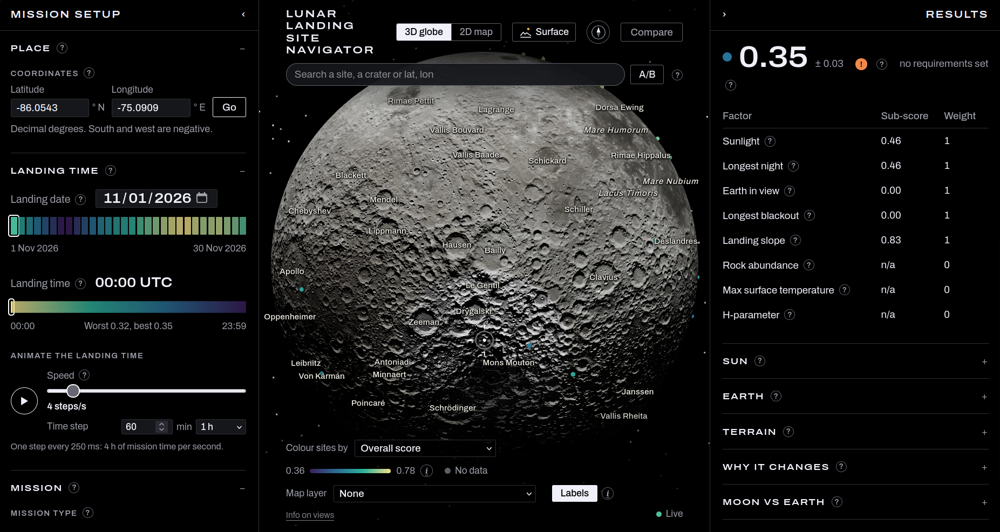
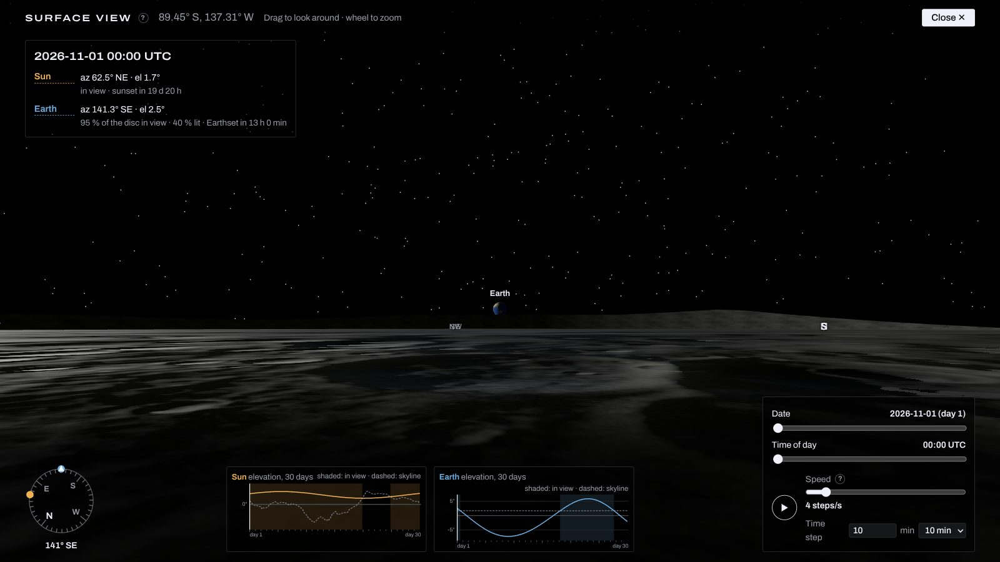
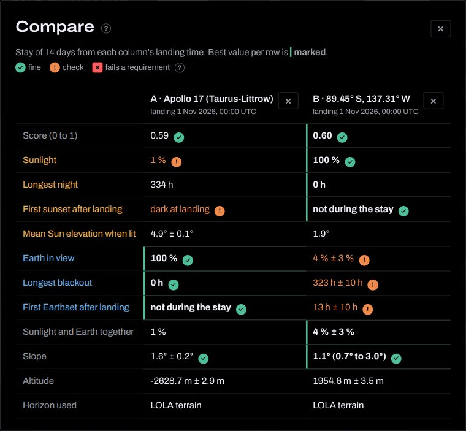
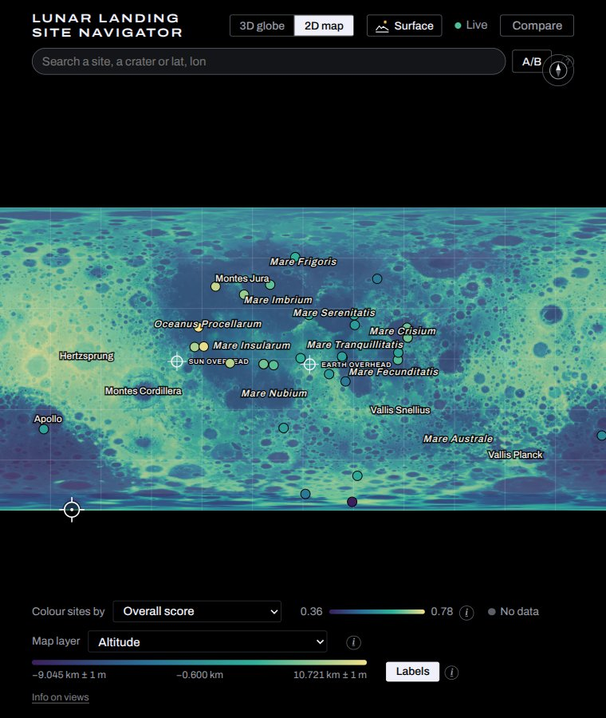
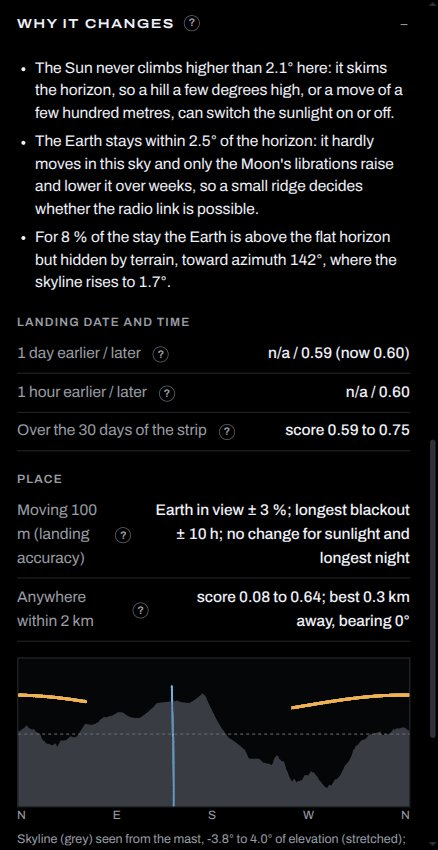
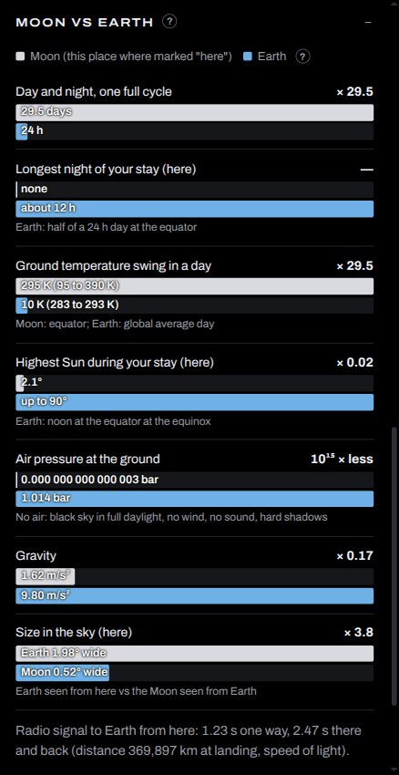
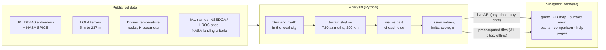

<p align="center">
  
  
  
  
</p>

<p align="center">Pick a place on the Moon and a landing date between 1850 and 2149.<br>
The navigator shows where the Sun and the Earth are over the real terrain, how long a lander keeps power and a link home,<br>
and how much that changes if you move a few hundred metres or a day.</p>

<p align="center">
  
</p>

---

## The problem

At the lunar south pole the Sun never gets more than a few degrees above the horizon and the Earth sits low on it. A ridge one degree high can decide whether a lander has sunlight on its solar arrays (power) and whether it can see the Earth for a direct radio link (communication). When a launch slips, planners need to re-check sites and dates quickly, but the tools that hold this data are built for specialists.

The navigator answers that question on one screen: which nearby site, or which other date, still works? It is meant for mission planners, educators and anyone curious about why landing on the Moon is hard.

## Features

- **Time left in view.** Countdown to sunset and Earthset with the exact UTC time, plus two bars showing when the Sun and the Earth are in view over the whole stay.
- **Warnings.** Red only when a requirement you set is broken. Orange when a value is at risk within the landing accuracy, or outside a published criterion (Artemis III slope 10°, Earth in view 25 %). Hover a badge to see the reason.
- **Search and A/B comparison.** Search the known landing sites, the 2 023 IAU feature names, or typed coordinates. Pick two points and compare them side by side, each at its own date.
- **Surface view.** A ground-level view from the chosen point: the real skyline from LOLA, with the Sun and the Earth moving over 30 days and rising and setting behind the terrain.
- **Why it changes.** What one day, one hour or 100 m does to the result, the score range within 2 km, and a short explanation based on the Sun's path against the skyline.
- **Moon vs Earth.** The differences drawn to scale: a 29.5-day day, a 295 K temperature swing, 10¹⁵ × less air, and the Earth appearing 3.8 × wider in the lunar sky than the Moon does from Earth.

<table>
<tr>
<td width="50%"></td>
<td width="50%"></td>
</tr>
<tr>
<td align="center"><sub>Surface view at 89.45° S: the Earth sits 2.5° above a real ridge</sub></td>
<td align="center"><sub>A/B: Apollo 17 is dark at landing; the pole point loses the Earth after 13 h</sub></td>
</tr>
<tr>
<td width="50%"></td>
<td width="50%"></td>
</tr>
<tr>
<td align="center"><sub>11 map layers with exact colour-bar ends and their accuracy (here: altitude ± 1 m)</sub></td>
<td align="center"><sub>Why it changes: reasons, sensitivity and the skyline panorama</sub></td>
</tr>
</table>

<p align="center"></p>

It also includes 31 known landing sites with cited coordinates (Apollo, Luna, Chang'e, Chandrayaan-3, SLIM, CLPS, ispace), robotic and crewed (Artemis III) mission presets, date and time-of-day strips coloured by the result, an animation of the landing time, nearby search, a whole-Moon score map, and a "?" next to every value that opens its documentation with formulas and references.

## How it works



- All calculations are done in the Python analysis; the web page only displays the results. Each number on screen can be traced to one function and one dataset.
- With no atmosphere, visibility comes down to terrain. The skyline is traced over the LOLA altitude maps in 720 directions out to 200 km, using the finest map available at each distance (5 m near the pole). A time step counts as in view when at least half of the Sun's or the Earth's disc is above the skyline.
- DE440 includes the Moon's actual rotation, so the librations (the Earth's slow sway in the lunar sky) come straight from the ephemeris rather than from a separate model.
- For uncertainty, every value is recomputed on a 100 m ring (the Artemis III landing accuracy) and with the skyline shifted by ± 0.1°.
- JSON Schemas in [`contracts/`](contracts/) define the shape of every file: units in field names, `{value, uncertainty}` for every displayed number, and `null` where no value is available. The live API and the offline files use the same schemas, so the front end works with either.

A longer write-up (concepts, data and methods) is in [How it works (PDF)](docs/BOPE-navigator-how-it-works.pdf).

## Validation

| Check | Result |
|---|---|
| Sun and Earth directions vs JPL Horizons (5 sites × 2 bodies × 12 instants) | largest difference 0.00069° as served, distances within 0.18 km |
| Terrain skyline vs NASA's LOLA long-term visibility maps (150 points south of 85.5° S) | correlation r = 0.982 (Sun), r = 0.996 (Earth) |
| Our 80 m slope vs NASA's 80 m slope map | median difference 0.10° to 0.17°, r ≥ 0.996 |
| Repeat period of sunlight / Earth visibility | 29.5 d (synodic month 29.53 d), 27.2 d at the pole (draconic month 27.21 d) |
| Documentation | every help page cites a source; citations are checked by automated tests |

Full details, including checks that are still open: [`docs/validation/navigator-audit.md`](docs/validation/navigator-audit.md).

## Running it

Front end (Node 20+), using the precomputed data for the 31 known sites:

```bash
cd frontend
npm install
npm run dev            # http://localhost:5173
```

Analysis server (Python 3.11+), needed for any other place, date or setting:

```bash
python -m venv .venv && .venv/bin/python -m pip install -r analysis/requirements.txt
.venv/bin/python -m analysis.download_kernels     # 45 MB of SPICE kernels from NASA NAIF
.venv/bin/python -m analysis.download_maps        # optional, ~3 GB of LOLA maps for the real terrain
.venv/bin/python -m uvicorn analysis.api:app --port 8000
```

With [uv](https://docs.astral.sh/uv/) installed you can run `npm run api` from `frontend/` instead. The page switches to **Live** once the server responds, and the interactive API docs are at `http://localhost:8000/docs`. On Windows, use `.venv\Scripts\python.exe`.

Tests: `npm test` in `frontend/` (273 tests), `python -m pytest analysis` (82 with all maps).

## Repository

```
analysis/      physics: ephemeris, terrain skyline, visibility, metrics, scoring, uncertainty, API
contracts/     JSON Schemas and API reference shared by both sides
data/          SITES.md, MAPS.md; processed/ = precomputed files (raw maps are downloaded, not committed)
frontend/      React + TypeScript + three.js navigator; src/docs/topics.ts = the help pages
docs/          PARAMETERS.md (every value and formula), DECISIONS.md, validation/, LOG.md, TASKS.md
```

| File | Contents |
|---|---|
| [docs/BOPE-navigator-how-it-works.pdf](docs/BOPE-navigator-how-it-works.pdf) | concepts, data and methods in 14 pages |
| [docs/PARAMETERS.md](docs/PARAMETERS.md) | every parameter, its formula and its source |
| [contracts/API.md](contracts/API.md) | the live API, endpoints and speeds |
| [data/MAPS.md](data/MAPS.md) · [data/SITES.md](data/SITES.md) | the NASA maps used and the 31 sites with their sources |
| [docs/DECISIONS.md](docs/DECISIONS.md) | design decisions, the reasoning, and the alternatives we rejected |
| [docs/CHALLENGE.md](docs/CHALLENGE.md) | the challenge text and our reading of it |

## Limitations

- "Earth in view" means geometric line of sight only. Deep Space Network station availability and link budgets are not modelled.
- The maps can't resolve boulders: slopes are measured over 80 m or more, and rock abundance only counts rocks larger than about 1 m.
- The score and the default warning bands are our own aids, not standards. The documentation notes wherever a value is our choice.
- Offline mode only covers the 31 known sites, landings at 00:00 UTC between November 2026 and April 2027, and the default settings. Anything else needs the analysis server and its maps.

## Team BOPE

| | Role |
|---|---|
| **Erdeniz Esmeli** | front end and integration (computer engineering) |
| **Gabriele Pisciotta** | analysis and physics model (aerospace engineering) |

## Credits

NASA/JPL (DE440, Horizons), NASA NAIF (SPICE), NASA GSFC PGDA and the LOLA team (altitude, slope, visibility and shadow maps), the Diviner team (temperature, rock abundance, H-parameter), NASA NSSDCA and LROC (site coordinates, imagery), NASA Scientific Visualization Studio (CGI Moon Kit), IAU / USGS Gazetteer of Planetary Nomenclature, Solar System Scope (Sun and Earth textures, CC BY 4.0), Wikipedia (mission summaries, CC BY-SA 4.0). Full references are in the PDF and on every help page.

AI use: code and documentation were written with the help of an AI coding assistant (Claude Code). Physics, data and results were checked against the NASA references above.