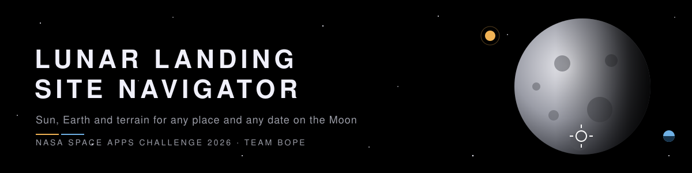

# Project description · Lunar Landing Site Navigator

NASA Space Apps Challenge 2026 · Team BOPE · challenge "Lunar Landing Site Navigator"

Text for the submission form, one section per field. Check the field names and length limits on the form before pasting.

---

## High-level project summary

We built a web navigator that answers, in seconds, the question mission planners face when a launch slips: *which nearby
site, or which other date, still works?* Choose any place on the Moon (click, search a crater, or type coordinates) and
any landing time from 1850 to 2149. The navigator shows where the Sun and the Earth are over the real LOLA terrain, how
long the lander keeps sunlight and a direct link to Earth, a countdown to sunset and Earthset, and whether the user's
requirements are met, with warnings, uncertainties and up to four places side by side. It explains *why* the south pole
is so sensitive (the Sun skims the horizon, the Earth only sways with the librations) and makes the extreme Moon–Earth
differences visible. Directions agree with JPL Horizons within 0.0007°, and our terrain skyline reproduces NASA's long-term
LOLA visibility maps with a correlation of 0.98 (Sun) and 0.996 (Earth).

## Links

| | |
|---|---|
| Final project (repository) | https://github.com/betelgeuse009/BOPE-lunar-navigator |
| Live demo | *TODO: URL once hosted (plan: static front end + analysis API on a small cloud server)* |
| Video / presentation | *TODO* |

## Project details

### What it does

- **Any place, any date.** The 3D globe, a 2D map and a street-level *surface view* show the chosen place. Landing date
  and time are set on two strips coloured by the result (30 days, and every 10 minutes of the chosen day), or played as
  an animation.
- **Power and communication at a glance.** Sunlight share, longest night, Earth in view, longest blackout, Sun and Earth
  elevation, the periods in view and how often they repeat, and the energy reaching a Sun-tracking array.
- **Time left before sunset and Earthset**, written as sentences ("Earthset in 12 h 51 min, 1 Nov 12:51 UTC") with the
  whole stay drawn as two bars.
- **Requirements and warnings.** Robotic or crewed presets (Artemis III values, each with its source) or your own
  limits. Badges mark each value: red when a requirement is broken, orange when it is at risk within the landing
  accuracy or outside a published criterion, green when fine.
- **Rapid comparison.** Up to four places side by side, each at its own landing time; an A/B search to compare two
  places in one step; a nearby search for a better spot within up to 50 km; a whole-Moon score map.
- **Why small changes matter.** For the chosen place: the result one day or one hour earlier or later, 100 m away and
  within 2 km, the reason in plain words, and a 360° skyline panorama with the paths of the Sun and the Earth.
- **Moon vs Earth.** Day length, nights, temperature swing, air pressure, gravity and the Earth's size in the sky,
  drawn to scale against everyday Earth values.
- **Every value explained.** A "?" next to each number opens its documentation: definition, formula, data, validation,
  limitations and references, more than 50 pages in all.

### How it works

The project is split in two on purpose. A **Python analysis** does all the physics; the **web navigator** (React,
TypeScript, three.js) only displays its answers, so every number traces back to one function and one dataset. The two
meet through a written **data contract** (JSON Schemas), which let both halves be built in parallel.

1. **Sun and Earth directions** come from the JPL DE440 ephemeris through NASA's SPICE toolkit, in the Moon's Mean
   Earth / Polar Axis frame, corrected for light time and aberration. The Moon's librations are part of the ephemeris.
2. **The horizon is the terrain.** With no atmosphere there is no refraction, so the skyline is the highest terrain in
   each direction: we trace it in 720 directions out to 200 km over the LOLA altitude maps (5 m near the pole, 80 m and
   240 m polar maps, 237 m globally), from the height of the lander's mast.
3. **In view** means at least half of the Sun's or the Earth's disc above that skyline, computed every 60 s over the
   stay. From these series come every mission value, the windows and the countdowns.
4. **Uncertainty** is propagated by recomputing every value on a 100 m ring around the place (the Artemis III landing
   accuracy) and with the skyline shifted by ± 0.1°.
5. **Live or offline.** The analysis runs as a web API for any place and setting; the same code precomputes files for
   31 known sites, so the navigator also works without a server.

### Benefits and intended impact

- **For mission planners:** a site-and-date trade study that takes minutes instead of a day of switching between
  specialist tools, with requirements, uncertainties and published criteria in view.
- **For science and engineering teams:** one shared, documented picture of the lighting and communication environment
  of a candidate site.
- **For educators and the public:** an intuitive way to see why landing near the lunar south pole is hard, from the
  sky of the place itself.

### Tools, languages and hardware

Python (numpy, spiceypy, FastAPI, rasterio), TypeScript, React, three.js (react-three-fiber), Vite, zustand, zod,
Vitest and pytest. Runs on a laptop; the full terrain needs about 7 GB of NASA maps.

### Creativity and what sets it apart

Most horizon tools stop at "the Sun is above the horizon". We count the visible part of the Sun's and the Earth's disc
against a real terrain skyline, give every value an uncertainty, say *why* the result changes, and back every number
with a source and a validation against NASA references.

## Use of artificial intelligence (AI)

The team used an AI coding assistant (Claude Code, Anthropic) to help write code, tests and documentation, and to
search literature. The physics model, the choice of datasets and every result were reviewed by the team and checked
against independent NASA references: JPL Horizons for the Sun and Earth directions, NASA's LOLA long-term visibility
maps for the terrain skyline. No AI-generated images or data are used in the application; the mission summaries on the
site cards are excerpts from Wikipedia (CC BY-SA 4.0), credited on each card.
*Check the Space Apps rules on AI disclosure and adjust this paragraph if needed.*

## NASA data

| Dataset | Used for |
|---|---|
| JPL DE440 planetary and lunar ephemeris, NAIF SPICE kernels | Sun and Earth directions, distances, Earth phase |
| JPL Horizons | validation of the directions |
| LOLA altitude maps (NASA PGDA products 81 and 90, LOLA GDR LDEM_128) | terrain skyline, altitude, slope |
| LOLA slope and height-error maps (PGDA 90) | slope, altitude uncertainty |
| LOLA long-term visibility maps AVGVISIB (PGDA 69, Mazarico et al. 2011) | validation, context values, map layer |
| LOLA permanently shadowed regions (LPSR) | map layer |
| LRO Diviner: Global Cumulative Product, Polar Resource Product, rock abundance, H-parameter (PDS) | temperature, regolith values and layers |
| LROC WAC south-pole mosaic, NASA SVS CGI Moon Kit | imagery of the globe and the map |
| NASA NSSDCA landing-site tables, LROC image measurements | coordinates of the 31 known sites |
| NASA Moon and Earth Fact Sheets | Moon vs Earth comparison |
| NASA Artemis III landing requirements (NTRS 20250009323), Apollo site-selection criteria | mission presets and warnings |

## Space agency partner and other data

- IAU / USGS Gazetteer of Planetary Nomenclature: feature names for the labels and the search.
- Solar System Scope textures (CC BY 4.0) for the Sun and the Earth; Wikipedia summaries (CC BY-SA 4.0) on the site cards.
- Published landing criteria of the Nova-C lander (Getchius et al. 2022).

## References

- Park, R. S. et al. (2021). The JPL Planetary and Lunar Ephemerides DE440 and DE441. *Astron. J.* 161, 105.
- Acton, C. H. (1996). Ancillary data services of NASA's Navigation and Ancillary Information Facility. *Planet. Space Sci.* 44, 65-70.
- Mazarico, E. et al. (2011). Illumination conditions of the lunar polar regions using LOLA topography. *Icarus* 211, 1066-1081.
- Barker, M. K. et al. LOLA south-pole altitude, slope and height-error maps. NASA PGDA product 90.
- Smith, D. E. et al. (2017). Summary of the results from the lunar orbiter laser altimeter after seven years in lunar orbit. *Icarus* 283, 70-91.
- Williams, J.-P. et al. (2017). The global surface temperatures of the Moon as measured by Diviner. *Icarus* 283, 300-325.
- Bandfield, J. L. et al. (2011). Lunar surface rock abundance and regolith fines temperatures from Diviner. *J. Geophys. Res.* 116, E00H02.
- Hayne, P. O. et al. (2017). Global regolith thermophysical properties of the Moon from Diviner. *J. Geophys. Res. Planets* 122, 2371-2400.
- Gläser, P. et al. (2014). Illumination conditions at the lunar south pole using high resolution DTMs from LOLA. *Icarus* 243, 78-90.
- Kopp, G. and Lean, J. L. (2011). A new, lower value of total solar irradiance. *Geophys. Res. Lett.* 38, L01706.
- Meeus, J. (1998). *Astronomical Algorithms*, 2nd ed. Willmann-Bell.
- NASA (2025). Key Artemis III Landing Requirements. NTRS 20250009323.
- Getchius, J. et al. (2022). Hazard Detection And Avoidance For The Nova-C Lander. arXiv:2204.00660.

The complete list, page by page, is in the navigator's help pages and in [How it works (PDF)](BOPE-navigator-how-it-works.pdf).
